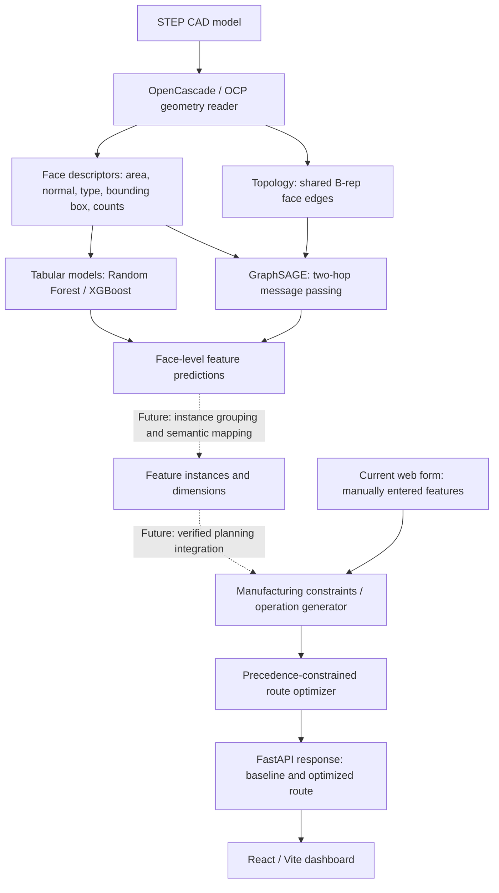
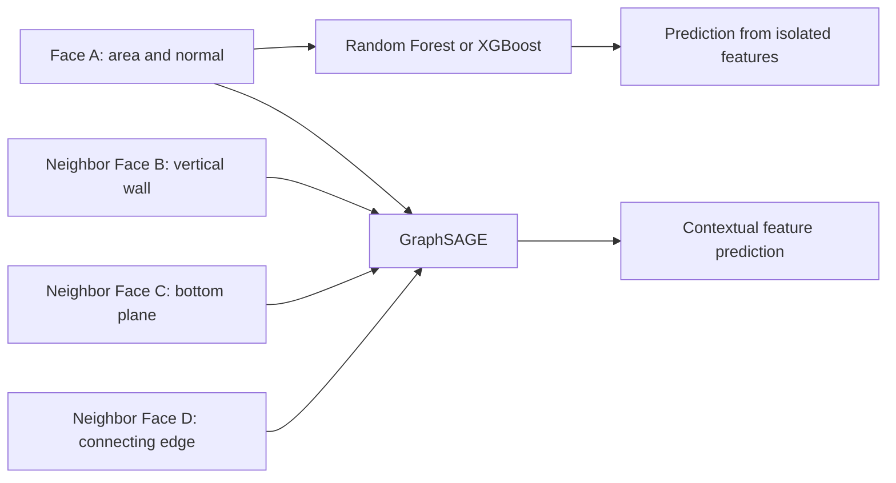

# ForgePath AI

### PS 04 | AI-Assisted Process Planning and Routing Chart Generation

**An explainable manufacturing research project built around real STEP geometry, face classification, graph neural networks, and constraint-based routing.**

**The goal:** turn a mechanical CAD part into an understandable and eventually machine-feasible manufacturing process plan. Today, the project has a working manual-feature routing prototype and separately validated machine-learning experiments. The automatic connection between them is the next major engineering milestone.

> **Status (13 October 2026):** Full MFCAD geometry and adjacency extraction, three classifier benchmarks, and the GraphSAGE adjacency ablation are complete. The web/API routing prototype is implemented. **Automatic prediction-to-routing integration, verified industrial process plans, and final held-out test evaluation remain future work.**

[](#research-objective) [](#dataset-and-data-integrity) [](#results) [](#evaluation-protocol)

## What is ForgePath AI? (Start here)

A mechanical CAD model tells us **what a part should look like**, but it does not normally tell a workshop **how to manufacture it**. A machinist or process planner must decide which surfaces to mill, which holes to drill, which tools and machines are compatible, and in what order operations can be performed.

ForgePath AI investigates whether that reasoning can be partially automated. It has **two currently separate components**:

1. **The usable website:** enter supported manufacturing features manually, specify available equipment, and request a baseline or optimized sequence of operations. The system creates an auditable routing chart with operation names, tools, selected machine, dependencies and illustrative time estimates.
2. **The experimental CAD intelligence engine:** read thousands of real STEP files, extract labeled geometric faces and graph connections, then train models to recognize machining-feature classes from those representations. Four completed validation comparisons are reported below.

**These components are not yet joined into automatic CAD-to-routing output.** A STEP upload currently provides optional geometry metadata, not a trained-feature prediction or an automatically verified operation route. We document this explicitly so that other developers and research reviewers can tell working software apart from proposed functionality.

### A concrete manufacturing example

Imagine a bracket that needs a flat top, four holes, a rectangular cavity, and a narrow slot. A manufacturing plan needs more than the words "drill and mill": 

| CAD/part requirement | Likely operation in the present manual-feature planner | Prerequisite | Example equipment |
|---|---|---|---|
| Flat reference face | Face milling | None in current prototype | CNC milling machine + face mill |
| Four holes | Spot drilling, then drilling | Spot drilling before drilling | Drill press or CNC mill; spot and twist drills |
| Supported pocket | Rough pocket, then finish pocket | Rough before finish | CNC mill + end mill |
| Supported slot | Slot milling | No additional rule beyond feasibility in current prototype | CNC mill + slot mill |

*This example describes the planner's current mapping rules, not instructions for machining a real part without engineering review.*

A valid future automatic system would need to identify those **feature instances from the STEP geometry**, estimate dimensions and setup directions, check accessibility/precedence/resources, and only then create a plan. Classifying one CAD *face* as a pocket-related face is not the same as detecting the entire pocket, let alone producing CNC toolpaths.

### What a project visitor can verify today

- There is genuine, locally reproducible ML code for **16-class CAD face recognition** using the original MFCAD dataset.
- There are fixed part-grouped development partitions, extraction audits, face-ID checks, a confusion matrix per model, and a graph/no-graph ablation.
- There is a functioning rule-based routing service with transparent rules and mathematical optimization for small operation sets.
- **Not yet established:** exact manufacturing feature instance detection, CAD-to-planner integration, shop-floor correctness, real cutting-time calibration, or final unseen-test/external-industry performance.

## Contents

1. [What is ForgePath AI?](#what-is-forgepath-ai-start-here)
2. [Research objective](#research-objective)
3. [What works today](#what-works-today)
4. [System architecture](#system-architecture)
5. [Dataset and data integrity](#dataset-and-data-integrity)
6. [Algorithms and implementation](#algorithms-and-implementation)
7. [Evaluation protocol](#evaluation-protocol)
8. [Results](#results)
9. [How to read the evaluation metrics](#how-to-read-the-evaluation-metrics)
10. [Why XGBoost trails Random Forest](#why-xgboost-trails-random-forest)
11. [Why graph adjacency matters](#why-graph-adjacency-matters)
12. [Completed phases and roadmap](#completed-phases-and-roadmap)
13. [Repository structure](#repository-structure)
14. [How to use the current application](#how-to-use-the-current-application-not-the-future-automatic-mode)
15. [Local setup and reproducibility](#local-setup-and-reproducibility)
16. [Limitations and publication notes](#limitations-and-publication-notes)
17. [Dataset attribution](#dataset-attribution)
18. [Project identity](#project-identity)

## Research objective

**Problem statement PS 04:** *AI-Assisted Process Planning and Routing Chart Generation.*

Manufacturing process planning transforms a component's geometric requirements into an ordered, feasible list of shop-floor operations, tools, and machines. Manual route preparation can be slow and difficult to adapt when requirements or resources change. This project investigates a pipeline that (1) interprets geometric features from CAD boundary representations, (2) identifies machining-feature classes, and (3) produces auditable operation sequences under explicit constraints.

The present study focuses experimentally on **face-level machining-feature recognition**. A separate rule-based routing baseline is operational, but **the trained recognizer is not yet integrated with that planner**. Feature-recognition performance is *not* evidence of manufacturing-route correctness.

**Current research questions**

- **RQ1:** How do Random Forest and XGBoost perform on geometry descriptors extracted from STEP CAD faces?
- **RQ2:** Does a two-layer mean-aggregation GraphSAGE model using actual CAD face adjacency outperform face-only baselines on the same development split?
- **RQ3:** How much performance is lost when the *same GraphSAGE architecture* receives no inter-face edges?
- **RQ4 (future):** Can predictions be grouped into machining features and converted into verified, constraint-feasible routing charts?

## What works today

| Subsystem | Implemented | Qualification |
|---|---|---|
| React/TypeScript manufacturing planner UI | Yes, prototype | Manual feature entry; service must be running |
| FastAPI service, feature catalog and route-generation API | Yes, baseline | Routing heuristics are illustrative |
| Rule-based feature-to-operation mapping | Yes | Supports a defined subset of holes, pockets, slots, planar faces |
| Sequential, precedence-aware route optimization | Yes | Exact dynamic programming for up to 14 operations; greedy for larger instances |
| Optional STEP geometry summary endpoint | Yes, optional CAD dependencies | Not automatic machining-feature recognition |
| Full MFCAD dataset extraction and annotation pairing | Yes | 15,488 parts, 350,295 labeled faces |
| CAD B-rep adjacency graph extraction | Yes | 15,488 graph files, 1,847,094 directed edges |
| 16-class Random Forest and XGBoost comparison | Yes | Validation experiments on frozen split |
| Pure PyTorch GraphSAGE and no-edge ablation | Yes | Validation experiments, single recorded seed |
| Automatic end-to-end CAD → classifier → route | **Not yet** | Needs feature grouping, semantic mapping and integration |
| Industrially calibrated cut times, CAM toolpaths and collision checks | **Not yet** | Not safe for production machining |
| Reserved test split evaluation, external industrial CAD test | **Not yet** | Do not present validation as final test accuracy |

## System architecture

### System overview: current state and future connection



**Solid arrows** show implemented individual research or application components. **Dotted arrows** represent planned integration, not currently functional end-to-end automation.

### Three layers and their responsibilities

| Layer | Input | Main job | Output | Status |
|---|---|---|---|---|
| Geometric interpretation | STEP model and numbered faces | Compute geometric measurements and adjacent-face graph | Per-face descriptors and graph links | Complete on original MFCAD |
| Feature classification | Geometry and, for GNN, graph links | Classify **individual faces** into the 16 MFCAD machining-feature classes | Class IDs / predictive scores | Trained and validated |
| Process planning | **Currently manually entered** compatible feature definitions and shop resources | Select allowable operations and order them under simple dependencies | Routing chart, tools, machines, heuristic time and changeover | Working baseline; automatic ML hookup pending |

### Why the three layers must be separated

A model can be good at recognizing an exposed geometric face yet poor at planning the manufacturing operation for the *whole object*. One machining feature often spans multiple faces, while two visually similar faces may have different manufacturing meaning depending on their neighbors. Separating identification, instance grouping, and manufacturing constraints prevents the software from interpreting a classification score as a verified machining instruction.


The system currently consists of two research/development paths, joined in a planned integration stage:

```text
                   ┌─────────────────────────────────┐
                   │ CAD (STEP) engineering component │
                   └────────────────┬────────────────┘
                                    │
                           OpenCascade / OCP
                                    │
            ┌───────────────────────┴─────────────────────┐
            │                                             │
  Geometry / face properties                     B-rep face adjacency
  type, area, position, bbox,                  shared topological edges
  normals, edge/neighbor counts                          │
            │                                             │
            └──────────────────┬──────────────────────────┘
                               │ face_id alignment
                     ┌─────────▼──────────┐
                     │ 16-class CAD face  │
                     │ feature recognition│
                     ├────────────────────┤
                     │ RF / XGBoost       │  tabular baselines
                     │ GraphSAGE          │  adjacency aware
                     └─────────┬──────────┘
                               │
                FUTURE: merge classified faces into
                machining features + verify geometry
                               │
                               ▼
                     ┌──────────────────────┐
                     │ Rule/constraint-based│
                     │ manufacturing planner│
                     └──────────┬───────────┘
                                │
                  Routing chart, tools, machines,
                   precedence and time estimates
                                │
                       React visualization

 CURRENT ROUTING MVP: User manually enters supported feature
 specifications → FastAPI planner → generated routing chart.
```

### Technology stack

- **Frontend:** React, TypeScript, Vite, Lucide React, CSS.
- **API and routing logic:** Python, FastAPI, Pydantic, Uvicorn.
- **CAD geometry:** STEP files, OpenCascade via `cadquery-ocp` / OCP; optional CadQuery STEP summary support.
- **Data science:** NumPy, pandas, scikit-learn, XGBoost, joblib.
- **Graph ML:** Native PyTorch, without mandatory PyTorch Geometric or DGL.
- **Experiment auditing:** JSON manifests, SHA-256 hashes, class counts, confusion matrices, part-disjoint split checks.

### CAD face descriptors

The extraction CSV contains `part_id`, `face_id`, `label` and engineered descriptors including:

- Surface type (categorical), face `log_area`, face area ratio.
- Face center coordinates and bounding-box spans in the STEP model coordinate system.
- Surface normal components (where defined by extraction), number of edges and number of adjacent faces.

`part_id`, `face_id`, and `label` are **not** supplied as predictive features. The face IDs are used to align geometry rows to graph nodes and labels. Note that `neighbor_count` is already a topology-derived scalar available to the tabular baselines; GraphSAGE adds explicit *which-face-connects-to-which-face* information.

### What the machine-learning models actually receive

Each row in the extracted face-level table is **one CAD face**, not one entire CAD model. For example, a single STEP bracket can produce twenty or more rows. Every row carries a `part_id` and numbered `face_id` for alignment, a class label for supervised training, and geometric descriptors used as features.

| Input column | Interpretation | Why it may matter |
|---|---|---|
| `surface_type` | Plane or another analytic surface category | Distinguishes planar from curved machining surfaces |
| `log_area`, `area_ratio` | Size of face and share of model area | Distinguishes tiny detail faces from broad stock faces |
| `center_x/y/z` | Face location | Can indicate where the surface sits in the part |
| `bbox_dx/dy/dz` | Axis-aligned face dimensions | Distinguishes thin edge faces from broad faces |
| `normal_x/y/z` | Surface orientation | May distinguish vertical walls, floors and sloped faces |
| `edge_count` | Boundary-edge count | Relates to shape complexity |
| `neighbor_count` | Number of adjacent faces, **as a scalar** | Coarse connectivity signal |

The tabular models know that a face has, say, six neighbors, but **do not know which six faces** they are or what those neighbors look like. GraphSAGE reads their embeddings through explicit shared-edge connections. `part_id`, `face_id`, and `label` must be excluded from predictor columns; face IDs are only for joining the labels, graph nodes and descriptors.

This distinction is key: a graph model can add relational information without requiring a larger or different set of per-face descriptors.

## Dataset and data integrity

**Primary dataset:** [MFCAD](https://github.com/hducg/MFCAD), original machining-feature CAD benchmark. This project works with the original `.step` and paired `.face_truth` files. The `.face_truth` annotations label **individual CAD faces**, not complete production plans.

| Extraction/audit item | Measured count |
|---|---:|
| STEP parts | 15,488 |
| Annotation files | 15,488 |
| Matched part/label pairs | 15,488 |
| Unmatched annotations | 0 |
| Invalid/unsupported annotation files in initial audit | 0 |
| Extracted labeled faces | 350,295 |
| Feature classes | 16 |
| Extracted adjacency graphs | 15,488 |
| Directed adjacency edges | 1,847,094 |
| Graph export failures | 0 |
| Isolated graph faces reported | 0 |

The largest annotation category is `stock` (102,581 of 350,295 face labels), so accuracy is presented alongside macro F1 and balanced accuracy. All 16 categories occur in each reserved split.

### Frozen development split (provisional family grouping)

| Partition | CAD parts | Labeled faces | Purpose |
|---|---:|---:|---|
| Training | 10,839 | 245,218 | Fit preprocessing and learned weights |
| Validation | 2,325 | 53,349 | Model selection and development reports |
| Reserved final test | 2,324 | 51,728 | **Not evaluated yet** |
| **Total** | **15,488** | **350,295** | |

The split is stored locally as `research_outputs/splits/mfcad_full_provisional_group_v1.json` and groups parts by the first four hyphen-separated filename components. Split audits found **zero identical part-ID overlaps**, **zero cross-split SHA-256 exact-byte STEP duplicates**, and **zero cross-split candidates under the implemented geometry fingerprint**. The candidate grouping and fingerprint checks are **not proof of independence among all similar CAD designs**. The reserved test set also excludes candidate filename families used in earlier pilot experiments.

The dataset's `.face_truth` data is not blindly shuffled against CAD faces: the extractor/graph loader checks numbered STEP face IDs against annotation positions and rejects nonmatching graph-to-feature alignment.

### Class definition and annotation alignment

MFCAD provides `.step` files and a matching `.face_truth` pickle for each part. The labels refer to **numbered STEP faces**. The original research code reads the identifier embedded in the STEP representation to align each geometric face to the right annotation index. Our extractor was debugged specifically around OpenCascade bounding-box and `TopoDS.Face`/`TopoDS.Edge` API differences, then run against all 15,488 files with no skipped parts.

The dataset contains 16 categories: rectangular/triangular slots; rectangular/triangular/hexagonal passages; various through and blind steps; rectangular/triangular/hexagonal pockets; chamfer; and stock. This vocabulary is **not identical** to the manual routing UI vocabulary (`planar_face`, `hole`, `pocket`, `slot`). A future mapping must use verified *feature instances* and supported operation definitions, not simply rename classification labels.

### Data-split strategy and threats to validity

1. The 200- and 1,000-part experiments were pilots for debugging and early measurements. They were not the paper's final test partition.
2. Before scaling, a new 70/15/15-ish development split was created across 15,488 parts using a provisional filename-prefix candidate family (first four hyphen-separated components).
3. The **train and validation sets** were used for model development. The **2,324-part reserved final test** was not evaluated for the displayed model leaderboard.
4. Automated checks covered identical part IDs, candidate grouping overlaps, exact STEP byte duplicates and geometry fingerprints. They did **not** establish rigorous geometric-family independence: structurally similar procedural parts could still cross the split.
5. The final paper should report repeated-seed variability and a genuinely independent dataset or stricter geometry-family evaluation before promoting validation scores to external-generalization claims.

This design deliberately protects against an easy but serious error: randomly splitting individual faces would put different faces of the **same part** into training and evaluation, creating an unfairly easy benchmark.

## Algorithms and implementation

### How the algorithms differ (plain-language explanation)

Think of **Random Forest** as many decision trees voting on what a single face is. **XGBoost** trains trees sequentially, where later trees focus on patterns the earlier ones still predict poorly. **GraphSAGE** learns a representation for each face partly from the measurements of the faces next to it.

| Method | Learns from | Strong point | What it misses or risks |
|---|---|---|---|
| Random Forest | One row of engineered measurements per face | Strong tabular baseline; robust bagged trees | No identities/features of neighboring faces |
| XGBoost | Same row-wise engineered measurements | Can fit nonlinear residual patterns through boosting | Hyperparameter sensitivity; still no explicit neighborhood graph |
| GraphSAGE with edges | Row-wise measurements **plus actual neighboring faces** | Learns local relational shape context | More compute; potential dataset-specific topology shortcuts |
| GraphSAGE without edges | Same network and descriptors but no graph messages | Controls for neural network capacity without connectivity | Does not use any actual neighbor descriptions |

**Why this is a meaningful experimental design:** if the real-edge and no-edge versions are otherwise aligned, the observed score difference helps isolate the predictive value of graph connectivity on the current benchmark. It still needs replication and checks for dataset-specific artifacts.

### 1. Rule-based manufacturing routing baseline

The *application* baseline currently accepts **manually specified** holes, pockets, slots and planar faces:

- `planar_face` → face milling.
- `hole` → spot drilling then drilling.
- `pocket` → rough milling then finish milling.
- `slot` → slot milling.

The planner checks required tools and available machines, preserves each feature's operation precedence and compares the feature-order route with an optimized sequence. A tool change adds an **illustrative** 1.5 minutes; a machine change adds an **illustrative** 3.0 minutes. Processing-time functions depend on feature dimensions, quantity and a simplified material factor. They are *not* experimentally calibrated cutting-time estimates.

For **≤14 operations**, the implementation uses exact **precedence-constrained dynamic programming** over `(completed-operation mask, previous operation)`, minimizing the modeled sequential changeover cost. For **>14 operations**, it uses a deterministic ready-operation greedy heuristic. If a heuristic sequence is worse than feature order, the baseline is retained. This is **not** a full multi-machine job-shop scheduler, CAM toolpath generator, or proof of machining feasibility.

### What is being optimized in the routing prototype?

The objective is the sum of illustrative operation processing times plus penalties for changing tools and machines along a **sequential** route:

\[
T_{\mathrm{route}}=\sum_{i=1}^{n} t_i + 1.5\,N_{\mathrm{tool\ changes}} + 3.0\,N_{\mathrm{machine\ changes}}.
\]

The coefficients are measured in **minutes per change** and are demonstration assumptions, not values determined from shop-floor experiments. For each multi-step feature, the operation sequence must respect dependencies such as **spot drill before drill** and **rough pocket before finish pocket**. Unavailable required tools or machines produce a validation error rather than a fictitious plan.

The exact optimizer applies a dynamic-programming recurrence over the set of completed operations (represented by a bitmask) and the last operation performed. It is exact **only for this simplified sequential changeover model** with up to fourteen operations. For more operations, a deterministic greedy rule chooses an available next operation with low immediate changeover cost. This optimization is **not** a trained ML model or an industrial CAM machining simulator.

### 2. Random Forest (tabular baseline)

- Library: scikit-learn `RandomForestClassifier`.
- 150 trees; `min_samples_leaf=2`, `class_weight='balanced_subsample'`, `random_state=42` and parallel CPU jobs.
- Surface type: training-fitted one-hot encoding; numeric face descriptors passed through.
- Part-group-disjoint training and validation; saved pipeline, confusion matrix and per-class metrics.

### 3. XGBoost (tabular comparison)

- Library: `XGBClassifier`, multiclass soft-probability objective (`multi:softprob`, 16 classes), histogram-based tree building.
- Fixed initial configuration: **200 boosting trees**, maximum depth **5**, learning rate **0.07**, `subsample=0.85`, `colsample_bytree=0.90`, `random_state=42`.
- Same face descriptors, one-hot feature handling and frozen train/validation part IDs as Random Forest.
- This is a **single fixed-configuration comparison**, not an exhaustive hyperparameter or compute-budget matched search.

### 4. GraphSAGE (CAD attributed adjacency graph)

Each CAD part becomes a graph: faces are nodes; shared OpenCascade B-rep edges produce graph links. Node attributes are the extracted numeric/categorical face descriptors. Feature labels are supervision targets and are **not included in the input graph files**.

The implemented pure-PyTorch network uses:

- Two GraphSAGE-style **mean-neighbor aggregation** layers, which concatenate each face's features with the mean of neighbor representations.
- Hidden width **64**, LayerNorm, ReLU, dropout **0.2**, and a 16-class output head.
- Train-only-fitted one-hot and `StandardScaler` preprocessing.
- Weighted cross-entropy; weights derived from inverse square-root class frequencies and capped, then normalized.
- AdamW optimizer, learning rate **0.001**, weight decay **0.0001**.
- Recorded run: seed **42**, maximum **30 epochs**, early-stopping patience **6**, batch **16 CAD parts**, CPU PyTorch; best validation epoch **20**.
- Saved state dictionary, preprocessing artifact, validation metrics and confusion matrix.

This is a simple **two-layer GraphSAGE-style baseline**, **not** a reproduction of AAGNet or a claim of architecture novelty.

### 5. GraphSAGE no-adjacency ablation

The separate ablation keeps the same feature set, split, preprocessing, model architecture, optimizer and training configuration, but removes **all inter-face edges in both training and validation**. This tests the contribution of the relational graph messages compared with the same neural model receiving face descriptors alone.

## Evaluation protocol

- **Task:** 16-way classification of individual CAD faces in the original MFCAD dataset.
- **Unit of independence for the current split:** Entire CAD part, provisionally grouped by filename-derived candidate design families.
- **Metrics:** Accuracy, balanced accuracy, macro F1, weighted F1, class precision/recall/F1 and confusion matrices. Macro F1 is prioritized due to class imbalance.
- **Comparability:** RF, XGBoost, GraphSAGE and its no-edge ablation use the same frozen *validation* CAD-part partition. Their algorithms and preprocessing differ where appropriate.
- **Integrity checks:** Total part/face counts, split-ID overlap, missing classes, file hashes, geometry fingerprint candidates, feature/graph alignment and a saved split-manifest SHA-256.
- **Limitations:** Single recorded seed for GraphSAGE/ablation; developer-visible validation data; no benchmark-controlled search over architectures and budgets; candidate filename grouping remains provisional; possible procedural family similarity; external industrial CAD generalization not yet measured.

> **Important:** All scores in the table below are **validation scores**, not the untouched final test set, and **not routing-chart accuracy**. No final production-readiness or journal-acceptance claim is made.

## Results

### Full MFCAD validation benchmark

| Model | Accuracy | Balanced accuracy | Macro F1 | Weighted F1 |
|---|---:|---:|---:|---:|
| Random Forest | 89.30% | 87.52% | 87.02% | 89.27% |
| XGBoost | 88.67% | 86.69% | 86.46% | 88.59% |
| GraphSAGE **without edges** | 87.261% | 84.491% | 84.731% | 87.182% |
| **GraphSAGE with actual CAD adjacency** | **99.696%** | **99.691%** | **99.694%** | **99.696%** |

The GraphSAGE artifact-integrity check confirmed **53,349 validation faces**, **2,325 validation CAD parts**, a matching frozen-manifest SHA-256, and scores recomputed from the saved confusion matrix. The checkpoint and preprocessing files exist. This confirms **internal consistency**, not external validity or complete freedom from leakage.

### Adjacency ablation: the principal experimental observation

With the same GraphSAGE architecture and descriptors, **real adjacency minus no edges** yielded:

| Metric | Real adjacency | No adjacency | Difference |
|---|---:|---:|---:|
| Validation accuracy | 99.696% | 87.261% | **+12.435 pp** |
| Balanced accuracy | 99.691% | 84.491% | **+15.199 pp** |
| Macro F1 | 99.694% | 84.731% | **+14.963 pp** |
| Weighted F1 | 99.696% | 87.182% | **+12.514 pp** |

Selected class-level macro-F1 improvements reported by the ablation:

| Feature | Real adjacency F1 | No-edge F1 | Gain |
|---|---:|---:|---:|
| Triangular pocket | 100.00% | 66.90% | +33.10 pp |
| Rectangular through step | 99.87% | 71.20% | +28.67 pp |
| Two-sided through step | 99.93% | 71.53% | +28.41 pp |
| Chamfer | 100.00% | 72.97% | +27.03 pp |
| Rectangular blind slot | 99.67% | 76.27% | +23.40 pp |

The only reported negative difference was `stock` (99.96% with edges versus 100.00% without, a 0.04-point difference). These figures are from **one validation run**, and extremely high performance on generated CAD warrants external and family-level stress tests before publication claims.

### Historical pilots (not directly comparable to the full validation set)

| Pilot experiment | Pilot test accuracy | Pilot test macro F1 |
|---|---:|---:|
| Random Forest, 200 CAD parts | 74.14% | 63.66% |
| Random Forest, 1,000 CAD parts | 84.35% | 79.26% |

The pilot tests used different sample partitions from the full benchmark. They are historical progress markers, **not a controlled learning curve**.

## How to read the evaluation metrics

**Accuracy** is the percentage of individual CAD faces receiving the correct label. Because `stock` is common, a model could have high accuracy while still being poor at recognizing difficult pockets or steps.

**Precision for class C** asks: among faces predicted to be C, how many really are C? **Recall for C** asks: among the actual C faces, how many did the model find? Their harmonic mean is **F1**:

\[
\mathrm{Precision}=
rac{TP}{TP+FP},\quad
\mathrm{Recall}=
rac{TP}{TP+FN},\quad
F_1=
rac{2PR}{P+R}.
\]

**Macro F1** averages F1 equally across all 16 classes, so a rare class matters as much as a common class. **Weighted F1** weights class contributions by their number of validation faces. **Balanced accuracy** averages recall over the classes.

| Metric | Used to answer | Why reported here |
|---|---|---|
| Accuracy | How many face labels are correct overall? | Intuitive first comparison |
| Balanced accuracy | How well does the model recall the average class? | Reduces dominance by stock class |
| Macro F1 | Is predictive quality reasonably balanced across all 16 feature types? | Primary selection metric in this study |
| Weighted F1 | How does performance look across the observed face distribution? | Useful secondary summary |
| Confusion matrix | Which actual feature types are being mislabeled as which others? | Identifies geometric ambiguities and guides research |

### A worked error-analysis example

The Random Forest frequently confused **triangular pocket** with **chamfer** (517 validation faces) and **rectangular blind slot** (444 validation faces). This explains why aggregate 89.30% accuracy can coexist with only **63.15% triangular-pocket F1**. The model has reasonably good average performance but struggles with certain fine distinctions. Adding another hundred boosting trees cannot provide the **identity of neighboring faces** if that information was never present in the input features.

The GraphSAGE ablation shows the triangular-pocket F1 rose from **66.90% (no edges)** to **100.00% (with real edges)** in the recorded validation run. That is evidence of an important contribution from graph connectivity **on this split**. It must not be interpreted as proof of perfect pocket recognition on arbitrary factory CAD.

## Why XGBoost trails Random Forest

**Observed:** Under the single recorded configuration, Random Forest leads XGBoost by approximately **0.63 percentage points of accuracy** and **0.56 percentage points of macro F1** on the same validation faces.

**We have not established a single causal reason.** Plausible explanations to investigate:

1. **Hyperparameters and optimization regime:** XGBoost used a fixed 200-tree/depth-5/learning-rate-0.07 configuration. Boosting performance is sensitive to tree complexity, shrinkage, regularization and early stopping; the experiment was not a matched model-search competition.
2. **Engineered face-level descriptors:** Random Forest can be very competitive on heterogeneous, finite-dimensional features with relatively clean class boundaries. Additional sequential boosting is not guaranteed to help.
3. **Class-specific trade-offs:** XGBoost improves **chamfer F1 from 73.73% to 77.37%** and **rectangular-through-step F1 from 72.61% to 73.97%**, but falls from **63.15% to 61.04% on triangular pockets**, **80.28% to 77.08% on rectangular blind slots**, and **86.10% to 83.53% on rectangular passages**.
4. **Missing relational structure:** Neither tabular classifier uses the actual identity and attributes of each neighboring face. Both receive isolated face features plus coarse counts. The graph experiment suggests this is a consequential limitation in the current benchmark, but does not prove it is the *only* explanation for RF-XGBoost differences.

A stronger comparison would pre-register comparable hyperparameter budgets, multiple seeds, calibration checks, computational cost and confidence intervals, without tuning to the reserved test set. **The result does not show that Random Forest is universally superior to XGBoost.**

## Why graph adjacency matters

A chamfer, pocket or step may be difficult to distinguish from a single face's area, normal and type. Its **neighboring faces and topology** can help identify whether it forms part of a recess, passage, cut edge or stepped surface.

A simplified GraphSAGE update is:

\[
\mathbf{h}_v^{(k+1)} = \sigma\left(\mathbf{W}^{(k)} [\,\mathbf{h}_v^{(k)} \Vert \operatorname{mean}_{u\in\mathcal N(v)}\mathbf{h}_u^{(k)}\,] + \mathbf{b}^{(k)}\right)
\]

where \(\mathcal N(v)\) is the set of CAD faces connected to face \(v\) by actual shared B-rep edges. Unlike RF/XGBoost's isolated rows, GraphSAGE can use **local relationships across two hops**.

The no-edge ablation strongly supports **an association between supplying true adjacency and higher validation accuracy on this MFCAD split**. It does not yet establish that the model will perform equally on unrelated industrial CAD, or that these face predictions can be safely converted to machining instructions. Future work must evaluate geometry-family generalization, graph topology perturbations, repeated seeds, unseen CAD distributions and uncertainty handling.

### Mechanism: what GraphSAGE adds that a flat classifier cannot



For a machining pocket, the meaning of one planar surface can depend on whether adjacent surfaces are pocket walls and on how faces connect into a cavity. Two GraphSAGE layers allow a node representation to incorporate information from its immediate neighbors and their neighbors. The graph comes from **actual shared B-rep edges**, not Euclidean nearest-neighbor guesses.

GraphSAGE's nearly perfect validation score should prompt additional checks: alternative graph construction, train/test splits based on verified geometric families, mislabeled-face audits, edge shuffling and degree-preserving randomized-edge controls, and external CAD data. A very high score can reflect useful geometry understanding, but also can reflect shortcuts tied to synthetic data generation or annotation conventions.

### Ablation interpretation: what it proves and does not prove

The no-edge experiment kept the same descriptors and neural architecture while removing cross-face connectivity from both training and validation. GraphSAGE with adjacency reached **99.694% macro F1**, whereas the no-edge version reached **84.731%**. The **14.963 percentage-point gap** strongly suggests relational information is useful in the recorded experiment.

It **does not** yet establish publication-ready causal attribution because multiple seeds, training uncertainty, topology randomization and independent geometric-family validation are still outstanding. It also does not prove that 99% face-label prediction leads to 99% accurate manufacturing plans. Process planning is a separate task with its own constraints and ground truth.

## Completed phases and roadmap

| Phase | Scope | Status | Evidence / next criterion |
|---|---|---|---|
| **0** | PS 04 problem scoping, research question and architecture | ✅ Completed | Project specification and research plan |
| **1** | ForgePath UI, FastAPI and deterministic routing baseline | ✅ Prototype completed | Working manual-feature route generation; prototype tests |
| **2** | Original MFCAD acquisition, label inspection, OpenCascade face extraction | ✅ Completed | 15,488 matched pairs, 350,295 extracted faces, zero skipped |
| **3** | Frozen-split audit + full Random Forest benchmark | ✅ Completed | 89.30% validation accuracy, 87.02% macro F1 |
| **4** | XGBoost comparator and per-class error analysis | ✅ Completed | 88.67% accuracy, 86.46% macro F1 |
| **5** | Full CAD graph export + two-layer GraphSAGE | ✅ Completed | 15,488 graphs, 1,847,094 edges, 99.694% macro F1 |
| **6** | No-edge GraphSAGE ablation | ✅ Completed | +14.963 pp macro F1 with actual adjacency |
| **7** | Repeated-seed trials, family-similarity audit, statistical analysis, error visualization | 🔜 Next | Confidence intervals, robustness and independent geometric review |
| **8** | Controlled additional baselines and graph/topology ablations | 🔜 Planned | Equal-budget comparison; test sensitivity to edges, features, hidden size |
| **9** | Face-to-feature grouping, geometry consistency and manufacturing semantics | 🔜 Planned | Validated pocket/step/slot/stock instances beyond per-face labels |
| **10** | Connect trained recognizer to routing engine and application | 🔜 Planned | Automatic STEP → predictions → verified feature instances → routing chart |
| **11** | Process-plan dataset/expert evaluation and constraint verification | 🔜 Planned | Feasible routes, operation accuracy, precedence/tool/machine constraint checks |
| **12** | External CAD evaluation, final reserved holdout protocol and manuscript | 🔜 Planned | Frozen candidate, one final test, independent validation, research paper |

These phase numbers track project milestones, not a claim that an industrial-ready product exists. **Phases 9-11 are crucial for completing the original PS 04 problem statement.**

### Detailed milestone explanation and acceptance gates

**Phases 0 and 1: Foundation and deterministic routing.** We turned the manufacturing PS into a modular React + FastAPI project. The first working demonstration accepts user-entered features and a small tool/machine catalog. It emits an auditable baseline route and a precedence-constrained optimized route. This matters because it creates a transparent planning reference that can later be compared against learned suggestions. **Gate for next planning phase:** demonstrate accurate CAD feature-instance dimensions and verified operation dependencies.

**Phase 2: Recovering trustworthy CAD labels.** We downloaded the original MFCAD, audited all STEP/annotation pairs, and fixed Python OpenCascade API incompatibilities (`Bnd_Box` conversion and `TopoDS` face/edge casting). All 15,488 parts and 350,295 faces were processed. Without face-ID alignment, a model might learn from incorrect labels; this phase prevented that failure mode.

**Phase 3: Strong tabular baseline and held-out development protocol.** We trained Random Forest first on small pilot subsets and then on the full training split. We reserved new, separate test parts and measured 89.30% accuracy / 87.02% macro F1 on the validation set. **Gate:** audit the preliminary filename grouping and preserve manifest checksums.

**Phase 4: Fairer model-family comparison.** A fixed XGBoost configuration used the same part groups and face descriptors. It scored 88.67% / 86.46% and was slightly weaker overall, though it improved some classes, including chamfer. This matters because the findings motivated a change in *data representation* rather than endless hyperparameter tuning.

**Phase 5: Explicit geometric relationships.** We exported 15,488 adjacency graphs and trained a two-layer GraphSAGE-style network; it scored 99.696% accuracy / 99.694% macro F1 on validation. Graph-to-label alignment and artifact consistency were checked. **Gate:** verify geometric-family robustness and graph-feature correctness independently.

**Phase 6: Controlled removal of graph edges.** Keeping the network and descriptors while deleting all inter-face edges reduced macro F1 to 84.731%. This isolates a useful experimental variable. **Gate:** repeat the comparison across seeds and with other graph controls; validate on genuinely independent CAD before claiming generalization.

**Phase 7: Reliability and statistical evaluation (next).** Run repeated-seed experiments, bootstrap confidence intervals clustered by CAD part, edge randomization and deeper family-similarity audits. Track inference latency, training time, parameter count and memory. A paper needs uncertainty and reproducibility, not one spectacular score.

**Phase 8: Additional controlled baselines and graph ablations.** Consider a shallow MLP using the exact GNN node features, stronger tuned tree baselines, 1-hop vs 2-hop models, ablations of normals/areas/neighbor counts, and graph corruption controls. Tune using train/validation only. Keep final test sealed.

**Phase 9: Whole-feature instances and manufacturing semantics.** Group predicted face labels into consistent physical cavities, slots, steps, surfaces and stock regions. Calculate dimensions, orientation and access direction. Reject ambiguous or infeasible groupings. This is necessary because MFCAD predicts *faces*, while manufacturing requires *features*.

**Phase 10: Real CAD-to-route integration.** Add a verified bridge from STEP parsing and trained predictions into the FastAPI planner; expand the planner catalog only for operations supported by validated dimensions, materials, machine capabilities and tooling. Show user-confirmed predictions, uncertainty and traceable routing rules in the UI.

**Phase 11: Manufacturing plan validation.** Assemble expert-reviewed operation-route references and constraint checklists for sample parts. Evaluate feature-instance detection, operation precision/recall, precedence violations, infeasible resource recommendations, quality of setups and runtime. MFCAD does not supply these plan labels, so this requires a separate data/annotation effort.

**Phase 12: Research release and manuscript.** After protocol and architecture are frozen, evaluate the untouched final split **once**, document external/industrial CAD generalization where possible, report uncertainty and computational cost, and prepare the manuscript with all limitations and reproducibility instructions.

## Repository structure

Representative layout after adding the research-phase scripts:

```text
PS04_Manufacturing_AI/
├── backend/
│   ├── app/                 # FastAPI, input models, route planner, optional CAD summary
│   ├── tests/               # Baseline application tests
│   └── requirements*.txt
├── frontend/
│   ├── src/                 # React/TypeScript manufacturing UI
│   └── package.json
├── research_training/
│   ├── extract_mfcad.py
│   ├── train_baseline.py
│   ├── audit_frozen_split.py
│   ├── train_frozen_split.py
│   ├── train_xgboost_frozen.py
│   ├── export_mfcad_adjacency.py
│   ├── train_graphsage_frozen.py
│   ├── train_graphsage_no_edges.py
│   └── compare_graphsage_ablation.py
├── data/
│   ├── sample_part.json
│   └── external/            # DOWNLOADED DATASETS, IGNORED BY GIT
├── research_outputs/       # GENERATED GRAPH FILES, METRICS & WEIGHTS, IGNORED BY GIT
├── docs/
├── README.md
└── .gitignore
```

The downloaded dataset and large `research_outputs/` artifacts are **not included in normal Git commits**. Record small result summaries in documentation, and archive versioned model outputs separately if permitted. A future reproducibility release should publish manifest *generation code*, source revision IDs, environment locks, non-sensitive result summaries and SHA-256 manifests without redistributing third-party datasets against their terms.

## How to use the current application (not the future automatic mode)

1. Run the backend and frontend separately, following the next section. The React site is served by Vite, so `npm run dev` belongs in **`frontend/`**, not in a Python virtual environment.
2. Open the manufacturing planner in your browser and enter a part name, material, supported feature types, quantities and dimensions.
3. Choose the available machines and tools. If an operation needs a tool that is not present, the API should return a validation error; this is intentional.
4. Submit to generate two routes: an input-order baseline and a precedence-constrained optimized route. Compare their operation tables, tool/machine changes and **illustrative** total minutes.
5. Optionally upload a `.step` or `.stp` file to receive a geometry summary, if CAD dependencies are installed. **This upload does not currently run the GraphSAGE model or automatically fill in the routing form.**

### FastAPI endpoints in the current prototype

| API | Method | Behavior |
|---|---|---|
| `/api/health` | GET | Backend running status; original baseline reports ML not connected |
| `/api/catalog` | GET | Supported manual features, materials, machines and tools |
| `/api/plan` | POST | Validate manually entered feature data; produce baseline/optimized route |
| `/api/analyze-step` | POST | Optional STEP geometry metadata; not feature inference |
| `/docs` | GET | FastAPI interactive API documentation |

### Example plan request (supported by current API)

```json
{
  "part_name": "Research demo bracket",
  "material": "aluminum",
  "features": [
    {"id":"face-1","kind":"planar_face","quantity":1,"length_mm":90,"width_mm":55},
    {"id":"hole-1","kind":"hole","quantity":4,"diameter_mm":8,"depth_mm":15},
    {"id":"pocket-1","kind":"pocket","quantity":1,"length_mm":40,"width_mm":25,"depth_mm":7},
    {"id":"slot-1","kind":"slot","quantity":1,"length_mm":36,"width_mm":8,"depth_mm":4}
  ],
  "available_machines": ["cnc_mill","drill_press"],
  "available_tools": ["face_mill","spot_drill","twist_drill","end_mill","slot_mill"]
}
```

You can paste this JSON into the Swagger interface at `http://127.0.0.1:8000/docs` under `POST /api/plan`. The result should contain route summaries, ordered operations and explanatory scope notes. **Do not interpret the route as certified cutting instructions.**

## Local setup and reproducibility

Tested by the project developer in **Windows PowerShell / VS Code**, using Python **3.13.11** for the research environment; CPU PyTorch was observed as **2.14.1+cpu**. Other versions may work but have not all been verified.

### Start the application

From the project root:

```powershell
cd D:\PS04_Manufacturing_AI_Starter\PS04_Manufacturing_AI

# Backend in its own terminal: create/install env if not already present
cd .\backend
py -3.13 -m venv .venv
.\.venv\Scripts\python.exe -m pip install -r requirements-dev.txt
.\.venv\Scripts\python.exe -m uvicorn app.main:app --reload --port 8000
```

In a **second terminal**:

```powershell
cd D:\PS04_Manufacturing_AI_Starter\PS04_Manufacturing_AI\frontend
npm install
npm run dev
```

Open `http://localhost:5173` for the UI and `http://127.0.0.1:8000/docs` for API documentation. If the UI says **Backend offline**, confirm the backend process is running.

### Prepare the research environment

```powershell
cd D:\PS04_Manufacturing_AI_Starter\PS04_Manufacturing_AI
py -3.13 -m venv .venv-ml
.\.venv-ml\Scripts\python.exe -m pip install numpy pandas scikit-learn joblib xgboost torch cadquery-ocp
```

These commands are a practical starting point, **not an exact lockfile**. For a publication-quality reproduction, freeze and record package versions and the MFCAD source commit.

Download original MFCAD independently from the author-maintained repository:

```powershell
New-Item -ItemType Directory -Force .\data\external | Out-Null
git clone --depth 1 https://github.com/hducg/MFCAD.git .\data\external\mfcad_original
```

### Core research commands

Run only after acquiring the dataset and installing the corresponding `research_training/` scripts:

```powershell
# Geometry descriptors: all CAD parts
.\.venv-ml\Scripts\python.exe .\research_training\extract_mfcad.py --max-parts 0 --output .\research_outputs\mfcad_full_face_features.csv

# Inspect frozen part-group split and annotation/geometry checks
.\.venv-ml\Scripts\python.exe .\research_training\audit_frozen_split.py --features-csv .\research_outputs\mfcad_full_face_features.csv

# Graph adjacency extraction
.\.venv-ml\Scripts\python.exe .\research_training\export_mfcad_adjacency.py --max-parts 15488

# Validation-only model evaluation
.\.venv-ml\Scripts\python.exe .\research_training\train_frozen_split.py
.\.venv-ml\Scripts\python.exe .\research_training\train_xgboost_frozen.py
.\.venv-ml\Scripts\python.exe .\research_training\train_graphsage_frozen.py --device cpu --epochs 30 --patience 6 --batch-parts 16
.\.venv-ml\Scripts\python.exe .\research_training\train_graphsage_no_edges.py --device cpu --epochs 30 --patience 6 --batch-parts 16 --seed 42
.\.venv-ml\Scripts\python.exe .\research_training\compare_graphsage_ablation.py
```

**Caution:** The freeze-split manifest was produced locally earlier and is not included in this documentation-only package. **Do not create a new arbitrary split and compare it with the numbers above.** Restore the original recorded manifest, verify its checksum and rerun the integrity audit before reproducing the experiments. The scripts refuse to overwrite some experiment output folders; use clean versioned output directories for repeats.

### Local application tests

```powershell
cd .\backend
.\.venv\Scripts\python.exe -m pytest -q
```

An initial backend test run on the original starter baseline reported **12 passing tests**. Treat this as historical development evidence, not a fresh CI status for the current working tree.

## Limitations and publication notes

1. **Validation is not the final test.** The held-out **2,324 CAD parts / 51,728 faces** have **not** been evaluated in the reported ML model comparison.
2. **Generated-data effects:** MFCAD contains procedurally generated components; near-perfect accuracy could overestimate performance on real manufacturer CAD. The current family-grouping heuristic and fingerprint screen do not resolve all geometric similarity concerns.
3. **Model selection risk:** Validation results were observed and used during development; a single run, no independently reported uncertainty bounds and unequal hyperparameter search budgets limit comparative claims.
4. **Task mismatch:** Classifying faces is different from recognizing complete machining-feature instances. Neither stage independently establishes a valid routing chart, toolpath or manufacturability.
5. **Feature mapping:** MFCAD's 16 classes (for example triangular pockets, passages and chamfers) are not identical to the current UI's four manual feature types. A validated semantic aggregation and translation layer is needed.
6. **Manufacturing estimates:** Current cutting and changeover times are heuristic demonstrations, not shop-floor calibrated or safety-certified parameters.
7. **Novelty:** GraphSAGE and adjacency-driven CAD learning pre-exist this project. Novelty for a paper must come from a verified new method, rigorous comparisons, or the CAD-to-routing contribution, **not** high validation accuracy alone.
8. **Reproducibility:** The full scripts, source code, frozen split generation protocol, upstream dataset revision, package versions and independent reruns must be audited before submission.

Do not use this prototype for unattended physical machining or claim production readiness without domain-expert verification.

## Dataset attribution

- Original [MFCAD author repository](https://github.com/hducg/MFCAD). Consult its original authors, associated publication and `LICENSE` before redistribution or manuscript citation. This README deliberately does **not** rehost the STEP dataset.
- **GraphSAGE** is an established family of graph neural networks. The implementation here is a simple mean-neighbor network written in native PyTorch, and should be described as such.

## Project identity

**ForgePath AI** is the working name for the PS 04 *AI-Assisted Process Planning and Routing Chart Generation* research prototype.

**Repository:** https://github.com/namgaydw-tech/AI-Assisted-Process-Planning-and-Routing-Chart-Generation

**Current scope:** research and prototyping; not yet a production-ready CAD/CAPP/CAM system.
